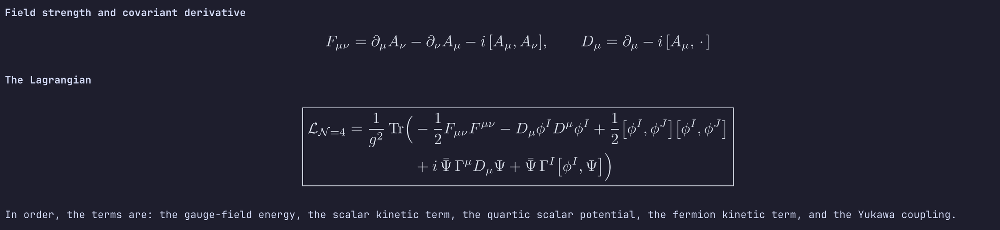

# Term-TeX

**Harness terminal LaTeX for Claude Code.**

A plugin for [Claude Code](https://claude.com/claude-code)'s harness (the layer that runs the model,
its tools and its terminal interface) that draws the LaTeX math in Claude's replies as real,
centered images in your terminal. Inline `$...$` becomes Unicode inside the sentence; display math
(`$$...$$`, `\[...\]`) is compiled with LaTeX and drawn as a picture.



*Term-TeX in Ghostty on macOS. Claude wrote the reply in plain LaTeX (the Lagrangian of N=4 super
Yang-Mills); the plugin draws the equations, including the boxed one, centered and scaled to the
terminal's text. The sentences around them are the unchanged reply.*

## Works with Claude Code only
- It is built on Claude Code's plugin hooks (it rewrites how an assistant message is drawn), so it
  does **not** work in other tools: not in Codex CLI, not in the claude.ai chat, not in a plain shell.
- Equation images are drawn only in a **terminal** that supports the kitty graphics protocol.
  Claude Code's other surfaces (the desktop app's Code tab, the VS Code extension) have not been tried.
- It has been tested with Claude Code in **Ghostty on macOS** and in **kitty on Linux** (Ubuntu on
  WSL2, through WSLg). Native Windows support is written but untried (see Platforms).
- Claude Code draws images with kitty's **Unicode placeholders**. A terminal that only implements
  the basic kitty graphics protocol is not enough: **WezTerm** shows the placeholder characters
  as text and draws no equation.
- It is an independent project, not made, endorsed or supported by Anthropic. "Claude" and
  "Claude Code" are trademarks of Anthropic, PBC; they are used here only to say what this
  plugin works with.

## Why this exists
Claude is very good at physics and mathematics, and it answers in LaTeX. A terminal cannot
draw LaTeX, so the answer arrives as raw `\frac{\partial \psi}{\partial t}` that you must
decode by eye. This mod is meant to speed up scientific work in physics, mathematics and
related fields for people who use Claude and LaTeX together: you read an equation as an
equation, check it, and send the source to your `.tex` file with `/math copy`, without leaving
the terminal. It is a tool for reading and checking maths while you work, not a general
document renderer.

## Requirements
- **A terminal with the kitty graphics protocol.** Ghostty or kitty (it must support Unicode placeholders; WezTerm and Windows Terminal do not). Elsewhere the
  equations stay as readable text (inline formulas still become Unicode).
- **TeX** providing `latex`, `dvipng` and the packages `standalone`, `amsmath`, `xcolor`.
  If something is missing, a toast says so once.
- **perl** (optional, found automatically) pads each equation to the terminal's cell grid and
  measures the terminal. It needs its `Compress::Zlib` module (Debian/Ubuntu: `perl-modules`;
  Fedora: `perl-IO-Compress`). Without perl, or without that module, equations are drawn at
  their natural size, slightly less exact, and a toast says why once.
- Optional LaTeX packages are loaded per equation when installed (a full TeX has them all):
  mathtools, bm, mathrsfs, cancel, physics, siunitx, tensor, upgreek, esint, stmaryrd,
  dsfont, mhchem, cases, units, nicefrac, xfrac, accents, extarrows, yhmath, mathdots, slashed.

## Platforms
| | TeX is looked for | perl | cache |
|---|---|---|---|
| **macOS** (tested) | PATH, `/Library/TeX/texbin`, Homebrew | `/usr/bin/perl` | `~/.cache/term-tex` |
| **Linux** (tested: Ubuntu on WSL2, kitty) | PATH, `/usr/bin`, `/usr/local/texlive/<year>/bin/<arch>` | system perl | `$XDG_CACHE_HOME` or `~/.cache` |
| **Windows** (best effort, untested) | PATH, MiKTeX, `C:/texlive/<year>/bin/windows` | TeX Live's or Git's perl, if any | `%LOCALAPPDATA%` |

- Linux packages (Debian/Ubuntu): `texlive-latex-extra texlive-science dvipng perl`.
- Windows: WezTerm and Windows Terminal do **not** draw the equations. WezTerm lacks Unicode
  placeholders, and ConPTY strips kitty graphics for its WSL domain. What works is kitty running
  inside WSL2 through WSLg (`sudo apt install kitty`, then `kitty &`).
  With MiKTeX, allow it to install missing packages on the fly, or a first run may stall.
- If the cell shape is measured wrong (no perl, an odd terminal): `/math ratio 0.46`
  sets the width/height ratio of one cell by hand; `/math ratio auto` measures again.

## Use
- On by default. `/math on|off` toggles it and is remembered across sessions.
- `/math color C` sets the ink colour. `/math ratio R` sets the cell shape by hand. `/math size N` sets how large equations are drawn (default 1.75, remembered); `/math debug` shows the last layout.
- `/math copy [N]` copies the LaTeX of the last (or N-th last) equation drawn; `/math list` shows the last five. Selecting an equation with the mouse copies the terminal's picture cells, not the LaTeX.
- An inline formula that Unicode cannot express (a matrix, a big fraction, limits) is not
  squeezed into the sentence: it is drawn as a display equation, centered, as if it had been
  written with `$$`. What fits in Unicode stays in the line.
- Prices such as `$5 and $10` and code (inline or fenced) are never touched.

## How it works and what it touches
- Everything runs locally; nothing goes over the network.
- Renders are cached (see Platforms for where). Pictures are dropped after 30 days and the
  files made while building them after one day.
- LaTeX runs with shell escape off and restricted file access, and formulas that
  use file or definition primitives (`\input`, `\write`, `\usepackage`...) are not compiled.
- Image colour follows the Claude Code theme. For the `auto` theme the mod asks the terminal
  (`COLORFGBG`) and then the system's light/dark setting (macOS, GNOME, Windows), and assumes
  dark if neither says. Wrong guess, or a terminal that differs from the system? `/math color
  dark|light|RRGGBB` sets the ink by hand and `/math color auto` gives the choice back.

## Install
```
/plugin install term-tex --marketplace FAgurtoS/Term-TeX
```
Answer `y` to add the marketplace, then pick a scope.

## Load it from a folder
- One session: `claude --plugin-dir /path/to/term-tex`
- Every session: `export CLAUDE_CODE_PLUGIN_DIRS="$HOME/.claude/mods/term-tex"` in `~/.zshrc`

## Develop
- `claude plugin validate .` and `claude plugin test .`

## Remove it
Delete this folder, the `CLAUDE_CODE_PLUGIN_DIRS` line if you added it, and
optionally `~/.cache/term-tex`. Nothing else was changed.

## License
MIT, see `LICENSE`.
